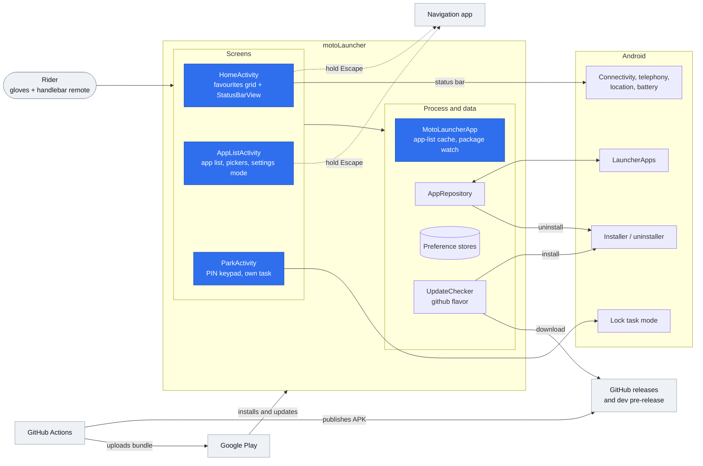
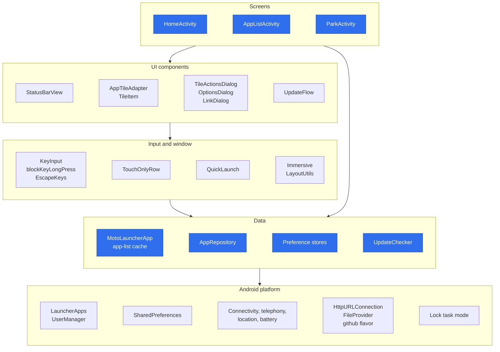
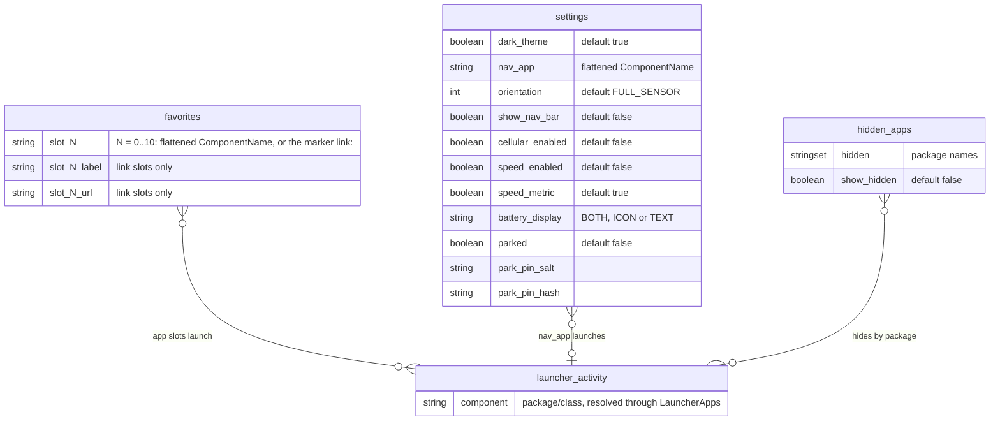

# Architecture

Blue nodes are primary components; the rest are secondary.

## High-level architecture

## Layers

Two components also reach the platform directly: `StatusBarView` reads the system
services, and `ParkActivity` calls lock task mode.

## Persistent state

There is no database. State lives in three `SharedPreferences` files, shown here as
entities.

