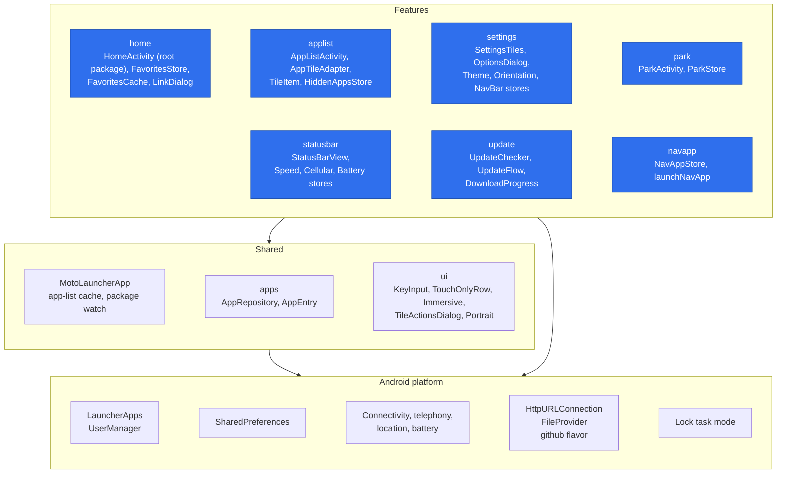
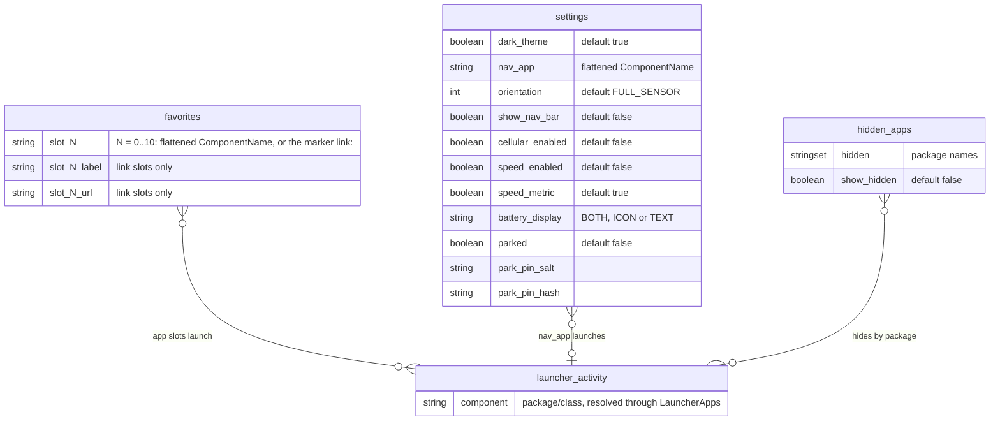

# Architecture

Blue nodes are primary components; the rest are secondary.

## High-level architecture

## Layers

Each feature package holds its screens, views and stores. `MotoLauncherApp` and
`HomeActivity` stay in the root package.

Features also use the platform directly: the status bar reads the system services, and
the park lock calls lock task mode.

## Persistent state

There is no database. State lives in three `SharedPreferences` files, shown here as
entities.

