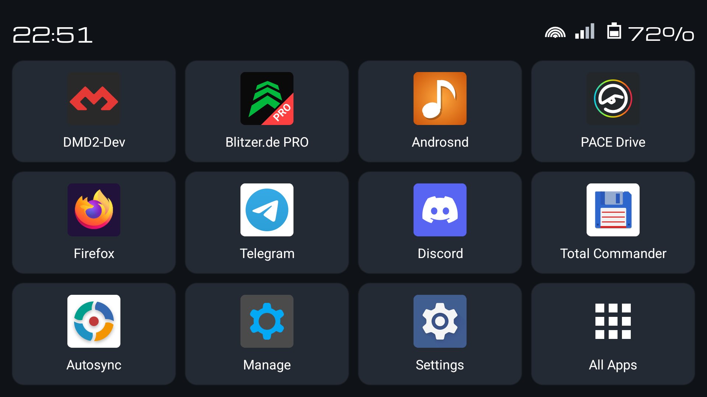
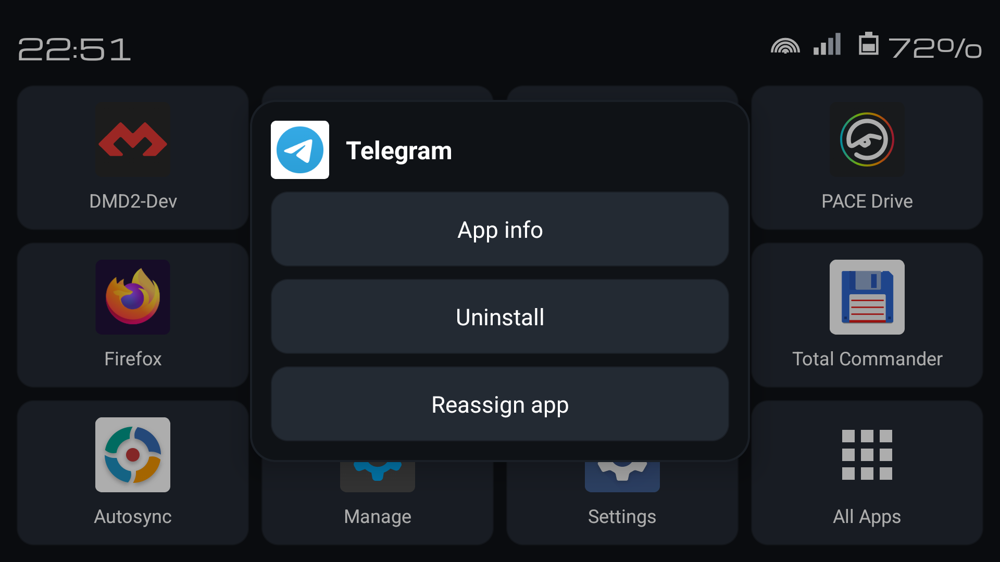
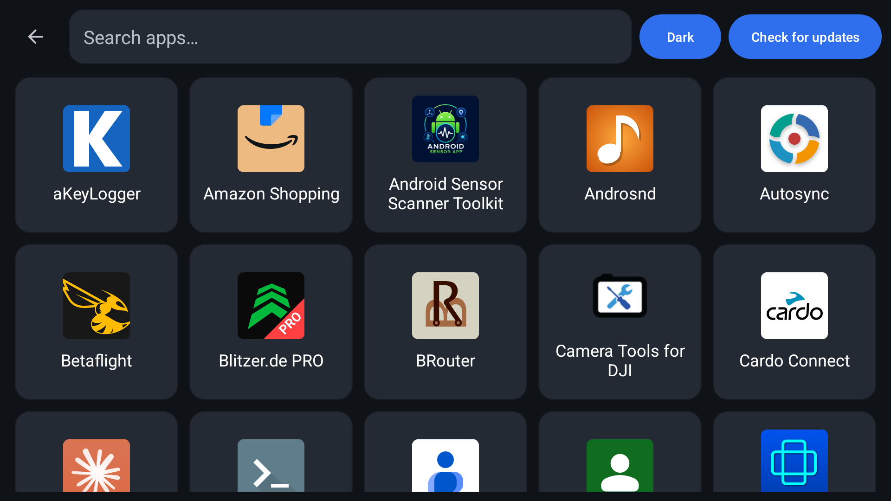
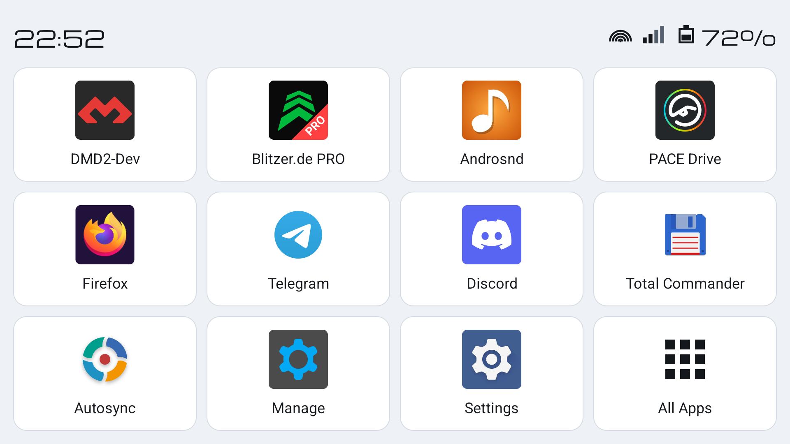

  

motoLauncher is an Android home screen for motorcycle navigation devices.
It is built for gloved hands and a handlebar remote.

## Features

- **Big-tile home grid** — eleven slots for apps or links, plus All Apps.
- **Remote control** — dpad, Enter and Escape. The remote can only launch, so it never gets stuck.
- **Hold Escape for navigation** — starts your navigation app from anywhere in the launcher.
- **All Apps** — search the list and hide the apps you never use.
- **Status bar** — time, GPS speed, Wi-Fi, cellular and battery.
- **Park lock** — a PIN keypad that pins the screen at short stops.
- **Updates on request** — the GitHub version checks only when you ask; the Play version updates through Google Play.
- **Themes and orientation** — dark or light; fixed orientation or auto-rotate.

## Screenshots

| Tile menu | All Apps | Light theme |
|---|---|---|
|  |  |  |

## Getting started

1. On Android 9 or newer, download the APK from the [latest release](https://github.com/c0dev0id/motoLauncher/releases/latest) and install it. Development builds are in the [dev pre-release](https://github.com/c0dev0id/motoLauncher/releases/tag/dev).
2. Press Home and choose motoLauncher as the default home app.
3. Tap an empty **+** tile to put an app or a link there.
4. Open **All Apps → Settings → Navigation app** and pick your navigation app.

## Remote keys

| Key | Home | All Apps |
|---|---|---|
| Dpad | Move the highlight | Move the highlight |
| Enter | Launch | Launch |
| Escape | — | Leave settings, then close |
| Hold Escape | Start the navigation app | Start the navigation app |

## Settings

In **All Apps → Settings**, by touch.

| Setting | Options |
|---|---|
| Theme | Dark (default), Light |
| Navigation app | Any app, or None |
| Check for updates | GitHub version: checks for a newer build and offers to install it |
| Park lock | Set a PIN, then lock; long press to change the PIN |
| Cellular indicator | Off (default), On |
| GPS Speed | Off (default), On |
| Units | km/h (default), mph |
| Battery | Icon + text (default), Icon only, Text only |
| Hidden apps | Hidden (default), Showing (dimmed) |
| Orientation | Sensor (default), Landscape, Portrait, Reverse landscape, Reverse portrait |
| Navigation bar | Hidden (default), Visible |
| Privacy policy | Shows the privacy policy |

The [user guide](docs/user-guide.md) walks through each of these.

## Credits

Michroma font: SIL Open Font License 1.1, see `MICHROMA-LICENSE.txt`.
